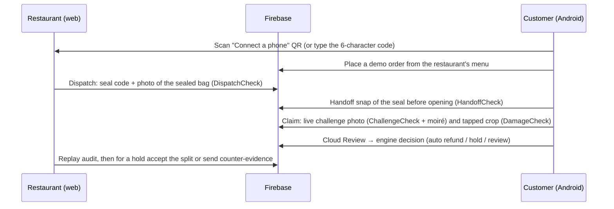
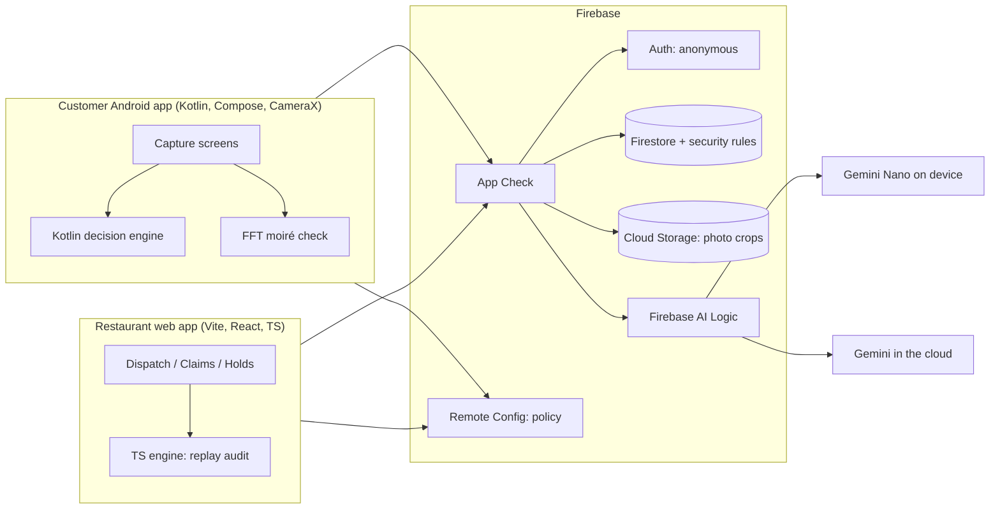

# FairClaim

**Fast refunds for honest customers. Proof for restaurants.**

FairClaim is a refund-claim system for food delivery, built for the **#BuildHybridAI 2026** hackathon (Nov 22–30, 2026).
Evidence is checked **when the photo is taken, on the device** (Gemini Nano through Firebase AI Logic hybrid inference, with a
cloud fallback). The refund is **proportionate to the damage and charged to the party responsible**, and it is set by a
deterministic rules engine, never by the model.

> Demo: _Vercel URL (coming soon)_ · Android APK: _GitHub Releases (coming soon)_ · Video: _YouTube (coming soon)_

---

## Contents

- [The problem](#the-problem)
- [How FairClaim answers it](#how-fairclaim-answers-it)
- [One order, start to finish](#one-order-start-to-finish)
- [Architecture](#architecture)
- [Hybrid AI: where each check runs](#hybrid-ai-where-each-check-runs)
- [The decision engine](#the-decision-engine)
- [Policy](#policy)
- [Security model](#security-model)
- [Privacy](#privacy)
- [Data model](#data-model)
- [Repository layout](#repository-layout)
- [Getting started](#getting-started)
- [Trying the whole flow](#trying-the-whole-flow)
- [Automated tests](#automated-tests)
- [Development tools](#development-tools)
- [Deploying](#deploying)
- [Cost and the free Spark plan](#cost-and-the-free-spark-plan)
- [Known limitations](#known-limitations)
- [Troubleshooting](#troubleshooting)
- [Production note](#production-note)
- [Further reading](#further-reading)
- [License](#license)

---

## The problem

When a delivery arrives spilled, short or wrong, the customer sends a photo and asks for a refund. Two things have broken
that process:

1. **Photos can be faked.** Generative AI can produce a convincing "spilled curry" picture in seconds, and an old photo or
   a photo of a screen works too. Platforms try to detect fakes *after* they are submitted, which is an arms race.
2. **Disputes are all-or-nothing.** Either the whole order is refunded (the restaurant pays for damage it didn't cause,
   and fraud is rewarded), or the claim is rejected (the honest customer loses). Nobody asks *who* was responsible:
   the kitchen or the delivery leg.

## How FairClaim answers it

FairClaim makes fake evidence **hard to create** instead of trying to spot it later, and splits the cost by evidence.

| Idea | What it does |
|---|---|
| **Seal code** | At dispatch the restaurant writes a random 4-digit code on the seal sticker and photographs the sealed bag. The code ties the packaging to this one order. |
| **Handoff snap** | Before opening the bag, the customer photographs the seal. Intact or broken at the door tells us whether anyone opened the bag on the way. |
| **Live challenge** | A claim photo must show the seal code **and** a random number of raised fingers, taken within 60 seconds of the challenge. A pre-made or downloaded photo can't know the finger count. |
| **Live capture only** | The customer app has no gallery and no file picker; the camera is the only way in. |
| **Screen-photo check** | An FFT moiré detector (no AI) plus a model flag catch photos of a screen. |
| **App Check** | Only the genuine app and web app can reach Firebase (Play Integrity on Android, reCAPTCHA Enterprise on the web). |
| **Rules decide money** | The model only describes what it sees, as validated JSON. A deterministic engine turns that evidence into an amount and a liability split. |
| **Proportionate refunds** | `price × severity` per item (minor 30%, partial 60%, total 100%), capped at the order total. |
| **Holds and counter-evidence** | When the evidence is unclear, the customer is still refunded, but who pays is held for 48 hours so the restaurant can answer with a photo. |
| **Replay audit** | The restaurant app recomputes every decision from the stored evidence and flags any mismatch. |
| **Explanations in three languages** | A cloud consistency review writes plain-language explanations in English, हिन्दी and தமிழ். |

## One order, start to finish



1. **Pairing.** Each restaurant web session creates its own sandbox restaurant with a seeded menu. The customer app scans
   the restaurant's QR code (`fairclaim://pair?code=…`) or types the 6-character code.
2. **Order.** The customer orders from that menu. Security rules check every name and price against the menu.
3. **Dispatch** (restaurant). The web app shows a random seal code. Staff write it on the sticker, seal the bag and take
   a photo. Gemini checks the seal is intact, reads the code and looks for outside damage. Only an intact seal with the
   right code is accepted (the rules enforce it).
4. **Handoff snap** (customer, before opening). Gemini checks the seal and reads the code. The snap is only saved if it is
   usable: seal visible and the right code. A broken seal with the right code is saved too, because it is evidence.
5. **Claim** (customer). Pick the issue (damaged, missing, wrong item) and the item(s). The app issues a live challenge:
   show the seal code and N fingers within 60 seconds. For damaged or wrong items the customer then taps the item in the
   photo, and that crop is checked for item, issue and severity.
6. **Decision.** The app re-reads the evidence from Firestore, runs a cloud consistency review, computes the decision with
   the engine and writes it. The rules check it against the policy.
7. **Restaurant side.** Every claim appears in the Claims log with its evidence and reasons. Holds appear under *Needs
   action*: accept the split, or answer with a counter-evidence photo within the hold window.

## Architecture



- **No backend server.** Both apps talk to Firebase directly. Security rules are the "server": they make evidence
  create-once and bound every decision (cap, totals, seal-code match, policy version).
- **One engine, two languages.** The TypeScript engine (`engine/`) is the reference; the Kotlin port
  (`apps/customer-android/engine/`) runs on the phone. Both must pass the same shared test vectors.
- **One policy file** (`packages/schemas/policy/policy.v1.json`) feeds the apps (bundled + Remote Config) and the
  security rules (Firestore `config/policy`).

## Hybrid AI: where each check runs

| Check | App | Firebase AI Logic mode | Output |
|---|---|---|---|
| `DispatchCheck`: seal intact, seal code, outside damage | Restaurant web (Chrome) | `PREFER_ON_DEVICE` | `seal_intact`, `seal_code_read`, `spill_or_damage_visible`, `confidence` |
| `HandoffCheck`: seal state before opening | Customer Android | `PREFER_ON_DEVICE` | `seal_state`, `seal_code_read`, `confidence` |
| `ChallengeCheck`: seal code + finger count on the full photo | Customer Android | `PREFER_ON_DEVICE` | `seal_code_read`, `fingers_visible`, `seal_state`, `photo_of_screen_suspected`, `confidence` |
| `DamageCheck`: the tapped crop | Customer Android | `PREFER_ON_DEVICE` | `matched_item`, `issue`, `severity`, `confidence` |
| `Review`: consistency + explanations (EN / हिन्दी / தமிழ்) | Customer Android | `ONLY_IN_CLOUD` | `consistent`, `flags`, explanations |
| Refund amount, liability, holds | Both (engine) | **no AI** | decision |

How a model call works:

- **Firebase AI Logic only.** Web: `firebase/ai`. Android: `firebase-ai` + `firebase-ai-ondevice`. The cloud model is
  `gemini-3.5-flash-lite` through the Gemini Developer API. There are no API keys in this repo or in the apps.
- **Structured output.** Every photo check asks for JSON with a schema (`@Generable` classes on Android). The raw text is
  then validated again by `parseModelOutput` against the JSON Schemas in `packages/schemas`. Output is normalised first
  (code → digits, enums lowercased, unknown keys dropped), so harmless verbosity doesn't fail a claim, but type errors do.
- **Retry ladder.** Hybrid call → if AICore reports `BUSY`, wait 0.8 s then 1.6 s and retry on device → any other error or
  an invalid answer gets **one** retry on a separate `ONLY_IN_CLOUD` model (the SDK doesn't fall back by itself once it has
  picked the on-device model). If Gemini in the cloud reports **high demand** (HTTP 503), the app waits 2 s, then 4 s, and
  tries the cloud once more. After that the check fails with a clear message and the user retakes; nothing is invented.
- **Where it ran is always shown.** Each result carries `inferenceSource` and the UI shows a badge
  (`ON-DEVICE · Gemini Nano` or `CLOUD · Gemini`).
- **Prompts never contain the answer.** No prompt includes the expected seal code or the finger count. The photo prompts
  are constant strings (unit-tested). The Review prompt gets the order's item names (sanitised, ≤ 60 characters) and only
  *whether* the code matched, never the code itself, and no prices.
- **Devices without Gemini Nano** (most phones, and every emulator) run every check in the cloud. Nothing else changes.

## The decision engine

AI gathers and checks evidence; rules decide money. The engine is pure and deterministic: no clock, no I/O.

**1. Verification gate.** Any failure sends the claim to human **review** with ₹0 refunded for now:

- seal code in the claim photo ≠ the order's code
- finger count ≠ the challenge
- photo taken before the challenge, or after the 60-second window
- moiré score over the threshold, or the model suspects a photo of a screen
- low confidence on the challenge photo or on the crop
- for damaged / wrong items: no crop check, no damage visible, a different problem than reported, or a different item
- refund over the instant-refund cap (₹500), or 3+ claims in 30 days
- the cloud review flagged a contradiction, or couldn't run

**2. Liability.** Who pays, from the seal evidence:

| Issue | Dispatch photo | Handoff snap | Outcome |
|---|---|---|---|
| Missing / wrong item | sealed, right code | seal intact | **Restaurant** (never packed) |
| Missing / wrong item | sealed, right code | seal broken | **Delivery** (tampered on the way) |
| Missing / wrong item | sealed, right code | none or unusable | Hold, 50/50 |
| Missing / wrong item | none | intact / broken | Hold leaning restaurant / delivery |
| Damaged | damage visible | any | **Restaurant** |
| Damaged | clean, high confidence | taken | **Delivery** (handling damage) |
| Damaged | clean, medium / low confidence, or no handoff | any | Hold leaning delivery |
| Damaged | none | any | Hold, 50/50 |

**3. Amount.** Per item `⌊(price × severity‰ + 500) / 1000⌋` (whole rupees, half up), summed and capped at the order total.
Severity: minor 300‰, partial 600‰, total / missing / wrong item 1000‰.

**4. Verdict.**

- **Auto refund:** verified and liability is clear. The responsible party pays all of it.
- **Hold:** verified, liability unclear. The customer **is refunded**; the split between restaurant and delivery is held
  for 48 hours. The split starts at 50/50 and moves up to 20 points toward the party the evidence points at, weighted by
  model confidence: 30/70 (high), 38/62 (medium), 44/56 (low).
- **Review:** something failed the gate. A person decides; ₹0 until then.

**5. Counter-evidence.** On a hold, the restaurant can answer with a photo of how the order was sealed. If it clearly shows
the seal intact with the right code (and no damage, for a damage claim), the hold settles in the restaurant's favour.
Otherwise the claim goes to human review. If the dispatch photo already proved the same thing, a second photo can't add
anything and goes to review (`counter_evidence_repeats_dispatch`). **The customer's refund never changes.**

Every decision carries stable reason codes (29 of them, English text in `packages/schemas/reason-codes.json`) and the
policy version it was computed with.

## Policy

All business numbers live in one file, `packages/schemas/policy/policy.v1.json`:

| Field | Value | Meaning |
|---|---|---|
| `autoApproveCap` | 500 | Largest refund (₹) that can be settled without a person |
| `claimHistoryLimit30d` | 3 | Claims in 30 days before new claims go to review |
| `challengeWindowSec` | 60 | Time to take the challenge photo |
| `moireThreshold` | 0.35 | Screen-photo score that fails the gate (placeholder until tested on more real photos) |
| `severityPermille` | 300 / 600 / 1000 | Minor / partial / total (missing and wrong item = 1000) |
| `handlingDamageLiable` | `transit` | Who pays for damage after a clean, sealed dispatch |
| `holdHours` | 48 | How long the restaurant has to answer a hold |
| `holdSplit` | 500 ± 200 | Base split and maximum confidence-weighted shift (‰) |

The same values reach three places, and they must match:

1. **Bundled in both apps** (the default).
2. **Remote Config**, generated into `remoteconfig.template.json` by `npm run gen`.
3. **Firestore `config/policy`**, which the security rules read (`policyVersion`, `autoApproveCap`, `holdHours`).
   A decision is refused if its `policyVersion` differs from this document.

To change a number, edit `policy.v1.json`, run `npm run gen`, redeploy Remote Config, update `config/policy`, and rebuild
the apps.

## Security model

- **The model never sets money.** It returns facts as JSON; the engine computes amounts; the rules bound them.
- **Rules as the server** (`firestore.rules`):
  - Evidence (dispatch, handoff, challenges, claims, decisions, holds) is **create-once**; updates and deletes are refused.
  - An order can only be created from the restaurant's own menu prices, and only dispatched once, by its restaurant.
  - A decision must match its claim and order, use the current `policyVersion`, respect the cap, and add up exactly. An
    auto refund also needs the claim photo's code to equal the order's seal code.
  - One claim per order; at least 30 s between claims and at most 5 per day per user; the claim must be written within
    120 s of the challenge (server time).
- **App Check** with limited-use tokens on every Firebase AI Logic call. Debug providers exist only in debug builds
  (`app/src/debug` on Android, dev builds on the web); `npm run check:dist` and `npm run check:apk` fail if one leaks into
  a release.
- **Server time, not phone time.** The challenge's `issuedAt` is server time, and `capturedAt` is that plus the phone's
  monotonic clock (`elapsedRealtime`), so a wrong phone clock can't fail an honest claim or help a dishonest one.
- **Android manifest:** only `CAMERA` and `INTERNET`; backups and cleartext traffic are off.
- **Never committed** (see `.gitignore`): `google-services.json`, `.env*` (except `.env.example`), keystores,
  `local.properties`, service-account keys, APKs and build output.

## Privacy

- On a phone with Gemini Nano, the full claim photo **never leaves the phone**: only the tapped crop and the JSON results
  are uploaded. On the cloud fallback the photo is sent to Gemini through Firebase AI Logic for that check only;
  FairClaim does not store it.
- Crops and counter-evidence photos are deleted after **3 days** (`storage.lifecycle.json`).
- **Delete my data** (Android Settings) deletes the customer's claims, crops and profile. Records the rules make
  create-once (orders, handoffs, decisions, holds…) stay, and the screen says so.
- Accounts are anonymous: no name, phone number or email is collected. Full text: `/terms` and `/privacy` on the web app.

## Data model

Firestore collections (all guarded by `firestore.rules`):

| Collection | Written by | Contents |
|---|---|---|
| `users/{uid}` | either app | Terms version accepted, time, role |
| `restaurants/{uid}` | restaurant | Name and menu |
| `pairCodes/{code}` | restaurant | Code → restaurant |
| `orders/{orderId}` | customer, then restaurant | Items, total, status, seal code |
| `dispatch/{orderId}` | restaurant | `DispatchCheck`, where it ran, photo hash |
| `handoff/{orderId}` | customer | `HandoffCheck` |
| `challenges/{claimId}` | customer | Finger count, server `issuedAt` |
| `claims/{claimId}` | customer | Issue, items, checks, moiré score, timing, crop hash |
| `claimsByOrder/{orderId}` | customer | One claim per order |
| `rateLimits/{uid}` | customer | Last claim time, count today |
| `decisions/{claimId}` | customer | Verdict, amount, liability, reasons, explanations, policy version |
| `holds/{claimId}` | customer, then restaurant | Held split and its settlement |
| `counterEvidence/{claimId}`, `resolutions/{claimId}` | restaurant | Answer to a hold and its outcome |
| `audits/{claimId}` | restaurant | Replay-audit result |
| `config/policy` | admin only | Policy mirror for the rules |

Cloud Storage paths: `claims/{claimId}/crop.jpg`, `dispatch/{orderId}/thumb.jpg`, `counter/{claimId}/photo.jpg`
(JPEG only, size-capped, create-once, see `storage.rules`).

## Repository layout

```
apps/
  restaurant-web/           Vite + React + TS restaurant app
    src/ai/                 Firebase AI Logic calls, prompts, retry ladder
    src/data/               Firestore reads/writes, dispatch, holds, replay audit
    src/ui/                 Pages: Overview, Needs action, Orders, Claims log
    terms.html privacy.html Static legal pages
  customer-android/
    app/                    Kotlin + Compose + CameraX customer app (com.fairclaim.customer)
      src/main/…/ai/        Firebase AI Logic (hybrid + cloud), prompts, retry ladder
      src/main/…/camera/    Live camera, QR scanning, crop geometry
      src/main/…/claim/     Handoff, claim and decision flows
      src/main/…/data/      Firestore documents and batched writes
      src/debug, src/release  App Check provider per build type
    engine/                 Kotlin port of the decision engine (pure JVM)
    fft/                    FFT moiré "photo of a screen" detector (pure JVM)
packages/schemas/           JSON Schemas, policy, reason codes, model-output parsing, shared test vectors
engine/                     TypeScript reference decision engine
rules-tests/                Firestore + Storage security-rules tests (emulator)
dev/                        Development-only tools (customer simulator); never in production builds
eval/                       Evaluation dataset and method
scripts/                    Policy seeding, build checks (check-dist, check-apk), Gradle wrapper
docs/DECISIONS.md           Every decision taken beyond the original plan
firestore.rules  storage.rules  storage.lifecycle.json  storage.cors.json
firebase.json  remoteconfig.template.json  vercel.json
```

## Getting started

### Prerequisites

| Tool | Version | Used for |
|---|---|---|
| Node.js | 24.12+ | Web app, engine, schemas, Firebase CLI (installed by `npm ci`) |
| JDK | 21 | Gradle and the Firebase emulators |
| Android Studio | current | Android SDK, emulator, Logcat |
| A Firebase project | Spark (free) is enough to start | See [Cost](#cost-and-the-free-spark-plan) |

```powershell
git clone https://github.com/yvssshubam/firebase-hybridai-buildathon.git
cd firebase-hybridai-buildathon
npm ci
```

### 1. Set up Firebase (console, one time)

1. **Create a project** in the [Firebase console](https://console.firebase.google.com).
2. **Authentication** → Sign-in method → enable **Anonymous**.
3. **Firestore Database** → create the database.
4. **AI Logic** → **Get started** → choose the **Gemini Developer API** (it works on the free Spark plan; the Vertex AI
   option needs Blaze). Check that the *Firebase AI Logic API* and the *Generative Language API* show as enabled.
5. **Add a web app** (Project settings → Your apps) and keep its config for step 3.
6. **Add an Android app** with package name `com.fairclaim.customer`. Add your debug SHA-1 and SHA-256
   (`.\gradlew.bat :app:signingReport` in `apps/customer-android`, or `keytool -list -v` on the debug keystore). Download
   `google-services.json` into `apps/customer-android/app/` (it is git-ignored).

### 2. Deploy the rules and the policy document

```powershell
npx firebase login
npx firebase deploy --only firestore:rules --project <your-project-id>
```

Then create Firestore **`config/policy`**, either with the seed script (needs Google Cloud application-default
credentials):

```powershell
npm run seed:policy -- <your-project-id>
```

or by hand in the console: collection `config`, document `policy`, fields `policyVersion` (string) `v1`,
`autoApproveCap` (int64) `500`, `holdHours` (int64) `48`.

> Deploy the rules again whenever `firestore.rules` changes. Out-of-date rules show up as `permission-denied`
> on writes that should work.

Optional: `npx firebase deploy --only remoteconfig --project <id>` publishes the policy to Remote Config (the apps fall
back to their bundled copy without it). Storage rules (`--only storage`) need a Storage bucket; see
[Cost](#cost-and-the-free-spark-plan).

### 3. Run the restaurant web app

```powershell
copy apps\restaurant-web\.env.example apps\restaurant-web\.env.local
# fill in the VITE_FIREBASE_* values from your web app config; keep VITE_USE_EMULATORS=false
npm run dev:web        # http://localhost:5173
```

In dev builds App Check uses a **debug token**: the browser console prints one on first load. Add it under App Check →
Apps → your web app → ⋮ → *Manage debug tokens* (or set your own in `VITE_APPCHECK_DEBUG_TOKEN`). Other `.env` switches:

| Variable | Effect |
|---|---|
| `VITE_USE_EMULATORS=true` | Auth / Firestore / Storage go to `npm run emulators` (AI Logic stays on the real project) |
| `VITE_DEMO_DATA=true` | Fills the pages with sample claims computed in the browser; nothing is written to Firebase |
| `VITE_ALLOW_PHOTO_UPLOAD=false` | Turns off the "For the demo" photo upload on dispatch and counter-evidence |

### 4. Build and run the Android app

Open `apps/customer-android` once in Android Studio so it writes `local.properties` with `sdk.dir` (or create it:
`sdk.dir=C:/Users/<you>/AppData/Local/Android/Sdk`). Then:

```powershell
cd apps\customer-android
.\gradlew.bat :app:assembleDebug :app:testDebugUnitTest
$adb = "$env:LOCALAPPDATA\Android\Sdk\platform-tools\adb.exe"
& $adb install -r app\build\outputs\apk\debug\app-debug.apk
& $adb shell am start -n com.fairclaim.customer/.ui.MainActivity
```

**Using the Android emulator instead of a phone:**

1. Android Studio → Device Manager → create a device (e.g. Pixel 8, API 36, a Google APIs image).
2. Edit it → *Show Advanced Settings* → **Camera → Back: Webcam0**, so the app's camera is your laptop webcam. (The
   default "VirtualScene" shows a 3D room.)
3. Start it, then install with the commands above. If `adb devices` lists nothing, run
   `& $adb kill-server; & $adb start-server`.
4. Emulators have no Gemini Nano, so every check runs in the cloud. That is expected.

**Register the App Check debug token** (debug builds only, once per install):

```powershell
& $adb logcat -d | Select-String "DebugAppCheckProvider"
```

Copy the token from the line that says `Firebase App Check debug token: …` and add it in the console: App Check → Apps →
the **Android** app → ⋮ → *Manage debug tokens*. Reinstall with `install -r` to keep the same token; uninstalling
creates a new one. Treat the token as a secret and delete it when you're done testing.

**Check everything works:** in the app, Settings → **Diagnostics**. You want:

- ✓ App Check token (debug)
- ✓ T0 cloud (`gemini-3.5-flash-lite`): `"OK" · IN_CLOUD`
- T1 on-device: ✓ only on a phone with Gemini Nano; ✗ "unavailable" on emulators and other phones is fine

## Trying the whole flow

You need something to act as a sealed bag: any paper or plastic bag, folded shut, with a sticky note across the fold.

1. **Web:** open the app; click **Connect a phone** to see the QR code and pair code.
2. **Android:** accept the Terms, scan the QR (or type the code), order a couple of items.
3. **Web → Orders:** open the order → **Open the camera**. Write the seal code shown on screen on the sticky note, large
   and dark, stick it across the bag's fold, and take the photo. Gemini must read the code and see the seal intact.
4. **Android → the order → Snap the sealed bag.** Show the bag with the sticker, 30–40 cm from the camera. Expect
   *Verified unboxing ✓*. (A loose note with no bag is rightly rejected: it doesn't show a sealed bag.)
5. **Android → Report a problem → Missing item**, pick an item, **Start the live challenge**. Hold up the requested number of
   fingers next to the sealed sticker and take the photo within 60 s.
6. **Result:** with the code and fingers read correctly, a missing item from a bag that was sealed at dispatch and intact
   at handoff is an **auto refund charged to the restaurant**. If the code or fingers weren't read, it goes to **review**
   with the reasons listed. Both are correct outcomes.
7. **Web → Claims log:** the same claim and decision appear, with the replay audit.

| To see | Do this |
|---|---|
| A hold | Skip the handoff snap, then claim a missing item |
| Review | Hold up the wrong number of fingers |
| Delivery liability | Peel the sticker (broken seal) before the handoff snap |
| Counter-evidence | On a hold, web → Needs action → answer with a photo |

## Automated tests

```powershell
npm run ci            # generated files up to date, lint, typecheck, unit tests (engine, schemas, web)
npm run test:kotlin   # Kotlin engine + FFT against the shared vectors (needs the Android SDK, see step 4)
npm run test:rules    # Firestore + Storage rules on the emulator (needs JDK 21)
npm run audit:prod    # npm audit of production dependencies
cd apps\customer-android; .\gradlew.bat :app:testDebugUnitTest   # Android JVM unit tests
```

**Shared test vectors** (`packages/schemas/test-vectors`) are written by hand, never produced by running an engine,
and both engines must pass every one:

| File | Vectors | Pins |
|---|---|---|
| `engine.vectors.json` | 81 | Gate, liability matrix, amounts and caps, verdicts, review downgrade |
| `counter-evidence.vectors.json` | 15 | Hold settlement from counter-evidence |
| `model-output.vectors.json` | 35 | JSON extraction, normalisation and schema validation of every model output |
| `item-match.vectors.json` | 11 | Item-name matching for the crop |

The Android unit tests also round-trip the engine vectors through the Firestore document shapes, check the batched
writes against the rules' exact field lists, check that no prompt mentions money or codes, and cover the model retry
ladder.

Release checks: `npm run build && npm run check:dist` (web build, scanned for debug tokens and dev code) and
`npm run check:apk -- <path-to-apk>` (release APK, scanned for the debug App Check provider, debug tokens, dev code and
private keys).

## Development tools

- **Emulators + customer simulator** (`dev/`): run the whole restaurant side against local Auth / Firestore / Storage
  emulators and play the customer from the command line (`npm run dev:customer -- order <code>`,
  `… claim <orderId> damaged|missing|nohandoff|unverified|tampered`). See [`dev/README.md`](dev/README.md).
- **Demo data:** `VITE_DEMO_DATA=true` fills the web pages with ~60 engine-computed sample claims and ~1,200 background
  orders, in memory only.
- **Diagnostics** (Android Settings): App Check provider and token, a cloud model call, on-device model status and a
  test call.

## Deploying

Coming in the final phase; the steps are:

1. **Web → Vercel.** Set the `VITE_*` variables (including `VITE_RECAPTCHA_ENTERPRISE_SITE_KEY` and
   `VITE_CONTACT_EMAIL`) in Vercel; a production build refuses to start without them, and fails if
   `VITE_APPCHECK_DEBUG_TOKEN` is set. Register the web app with reCAPTCHA Enterprise in App Check.
2. **Android release APK.** Create a keystore (never committed):
   `keytool -genkeypair -v -keystore %USERPROFILE%\.android\fairclaim-release.jks -alias fairclaim -keyalg RSA -keysize 2048 -validity 3650`.
   Put `fairclaim.keystore`, `fairclaim.keystorePassword`, `fairclaim.keyAlias`, `fairclaim.keyPassword` and
   `fairclaim.webBaseUrl=https://<your-vercel-domain>` in `apps/customer-android/local.properties` (git-ignored), then
   `.\gradlew.bat :app:assembleRelease` and `npm run check:apk -- apps/customer-android/app/build/outputs/apk/release/app-release.apk`.
3. **Play Integrity without Google Play.** Add the **release** SHA-256 to the Android app, enable the Play Integrity API
   in Google Cloud, and register Play Integrity in App Check with distribution **outside Google Play**. No Play Console
   account is needed.
4. **Turn on App Check enforcement** for Firestore and Firebase AI Logic once both release builds pass App Check.
5. **Publish** the APK as a GitHub Release.

Installing the judge build: download `app-release.apk` from GitHub Releases, allow "Install unknown apps" for your
browser or file manager, open the APK. No Gemini Nano is needed.

## Cost and the free Spark plan

Everything FairClaim uses so far runs on the **no-cost Spark plan** with no billing account: Authentication, Firestore,
App Check, Remote Config and Firebase AI Logic with the Gemini Developer API. With no billing account nothing can be
charged; when a free limit is reached (for example Gemini requests per minute or per day) that feature pauses until the
limit resets.

The exception is **Cloud Storage**: new projects on Spark have no default bucket. Without one:

- the dispatch **thumbnail** is skipped (the dispatch itself is still recorded, with the note "Thumbnail not stored");
- **damaged** and **wrong-item** claims can't upload their crop, so they stop with an error;
- **counter-evidence** photos can't be stored, and the replay audit can't compare crop hashes.

**Missing-item** claims need no crop and work end to end. Moving these small photos into Firestore documents, so the whole
app runs on Spark, is planned next.

## Known limitations

- Cloud Storage on Spark, as above.
- The moiré threshold (0.35) is a placeholder until it is tuned on more real photos.
- The 30-day claim count is counted on the phone and resets with a new anonymous account.
- On-device inference needs a phone with Gemini Nano (or Chrome with Gemini Nano for the web); everywhere else the same
  checks run in the cloud.
- The free Gemini tier has rate limits; under load, checks wait and retry, and may ask the user to try again a minute
  later.
- Adjudication runs on the customer's phone for the hackathon (see the next section).

## Troubleshooting

| Symptom | Cause | Fix |
|---|---|---|
| Diagnostics: *App attestation failed* (403) | Debug token not registered | Register the token from Logcat ([step 4](#4-build-and-run-the-android-app)); force-stop and reopen the app |
| *…requires the Firebase AI Logic API (`firebasevertexai.googleapis.com`) to be enabled* | AI Logic not set up | Console → AI Logic → Get started → Gemini Developer API; wait a few minutes |
| *This model is currently experiencing high demand* | Gemini cloud overload | The app retries automatically; if it still fails, wait a minute |
| T1 on-device ✗ unavailable | No Gemini Nano (all emulators, most phones) | Expected; the cloud is used |
| Web dispatch or Android claim: `permission-denied` | Deployed rules out of date, or `config/policy` missing | `npx firebase deploy --only firestore:rules --project <id>`; create `config/policy` |
| *This app uses policy v1 but the server expects …* | `config/policy` missing or different | Create or fix `config/policy` ([step 2](#2-deploy-the-rules-and-the-policy-document)) |
| *Thumbnail not stored (storage/retry-limit-exceeded)* | No Storage bucket (Spark) | Expected; the dispatch is saved |
| Handoff: *We couldn't see the seal sticker* | Photo shows a note, not a sealed bag, or is blurry | Stick the note across a bag's fold; hold it 30–40 cm away in good light |
| Web: *auth/network-request-failed* | `VITE_USE_EMULATORS=true` without emulators running, or the network / an extension blocking Firebase | Set it to `false` or run `npm run emulators`; check DevTools → Network |
| Gradle: *SDK location not found* | No `local.properties` | Add `sdk.dir=…` ([step 4](#4-build-and-run-the-android-app)) |
| `adb devices` is empty | adb server stuck | `& $adb kill-server; & $adb start-server` |
| Emulator camera shows a 3D room | Back camera is VirtualScene | AVD → Advanced Settings → Back camera: Webcam0 |

## Production note

For the hackathon, adjudication runs on the customer's phone: the app writes the decision, protected by App Check, bounded
by security rules (create-once, cap, totals, seal-code match, policy version) and re-checked by the restaurant app's
replay audit. In production the final refund decision would move to a server.

## Further reading

- [`docs/DECISIONS.md`](docs/DECISIONS.md): every decision taken beyond the original plan, and why
- [`packages/schemas/test-vectors/README.md`](packages/schemas/test-vectors/README.md): the exact engine rules and maths
- [`dev/README.md`](dev/README.md): emulators and the customer simulator

## License

[Apache-2.0](LICENSE)